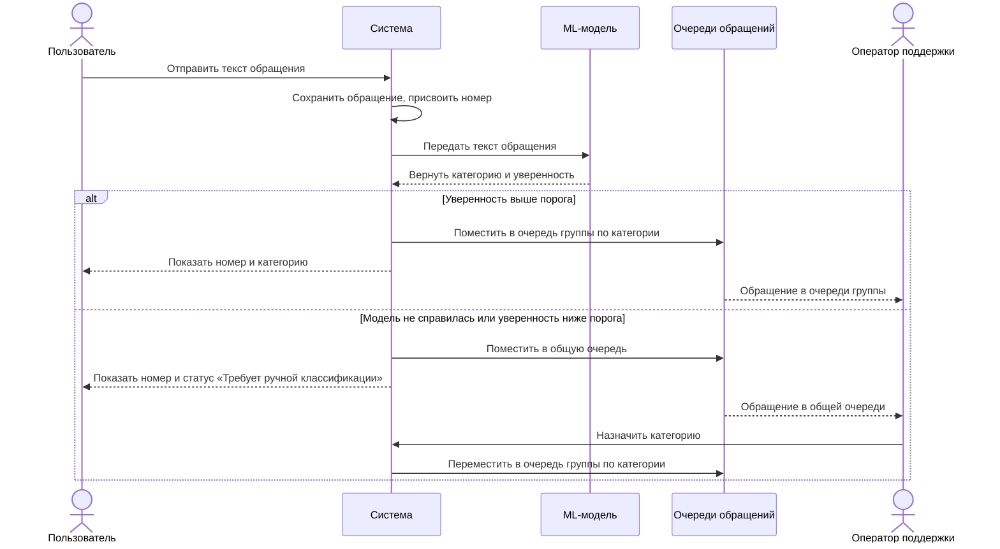
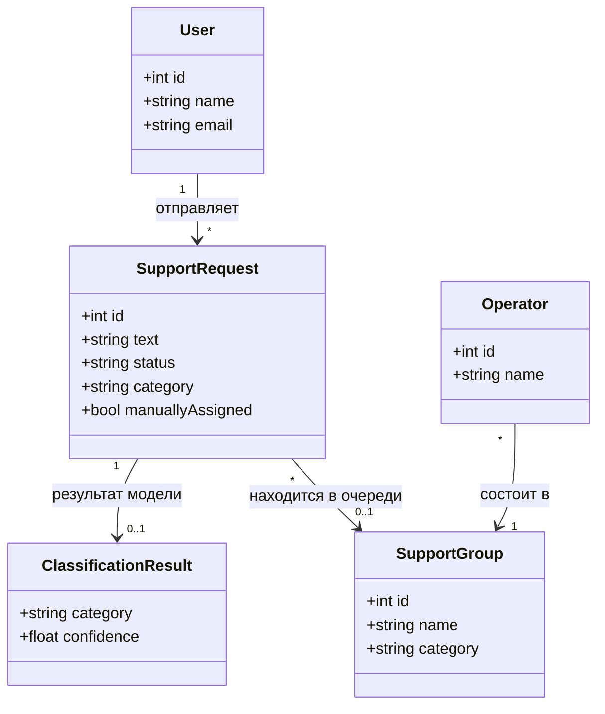

# Диаграммы

## Диаграмма последовательности

Диаграмма показывает выполнение сценария
[UC-01. Классификация и направление обращения](requirements.md#uc-01).

## Диаграмма классов

Диаграмма показывает основные сущности сервиса и связи между ними.

Пояснения к диаграмме:

- **SupportGroup** — группа поддержки с собственной очередью. Каждая группа
  отвечает за одну категорию: «Оплата», «Доступ», «Ошибка» или «Вопрос».
- **SupportRequest** — обращение. Если обращение не привязано к группе,
  оно находится в общей очереди и имеет статус «Требует ручной классификации».
  Флаг `manuallyAssigned` показывает, что категорию назначил оператор (US-03).
- **ClassificationResult** — ответ ML-модели. Его может не быть, если модель
  была недоступна (сценарий 3a в UC-01).
